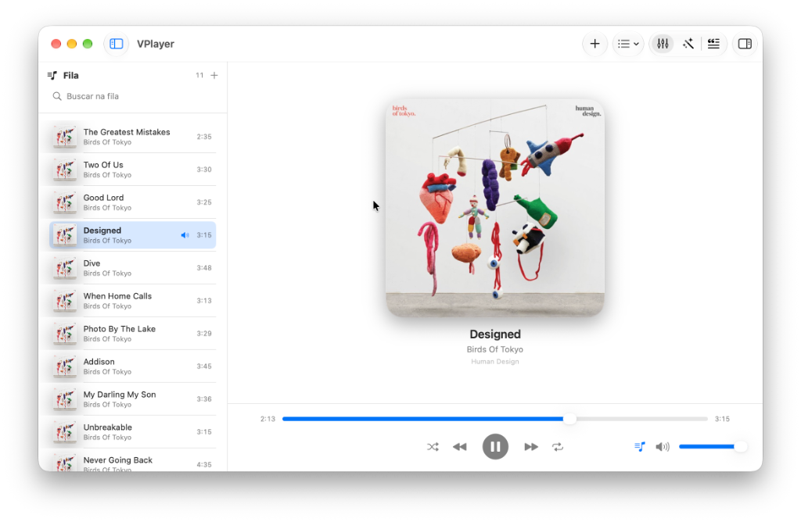
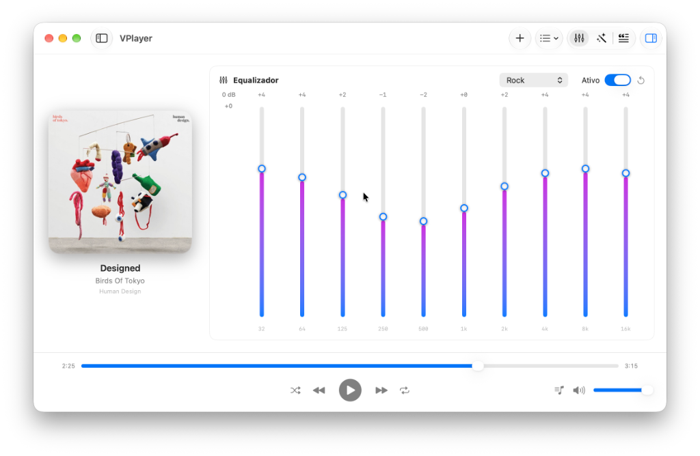
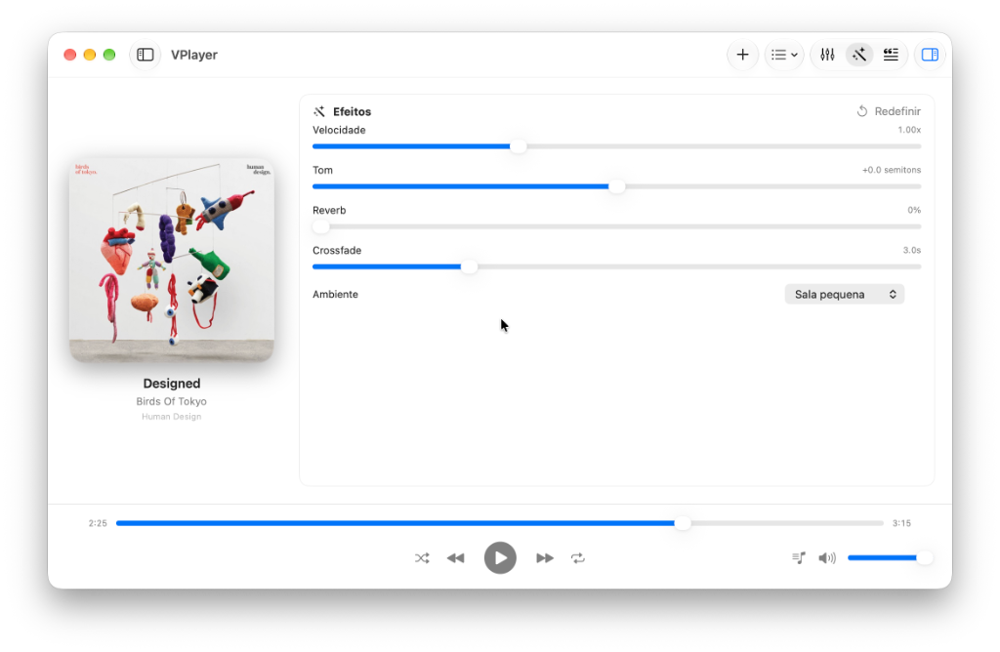

# VPlayer — Reprodutor de Áudio Nativo para macOS

VPlayer é um player de áudio nativo moderno, rápido e elegante para macOS, desenvolvido em **Swift** e **SwiftUI** utilizando **AVFoundation**.

---

## 📸 Capturas de Tela

### 1. Interface Principal & Fila de Reprodução
Visual limpo com acabamento em *glassmorphism*, capa do álbum em destaque, barra de controle inferior e painel lateral de fila retrátil com busca em tempo real.



---

### 2. Equalizador Gráfico de 10 Bandas
Equalizador de precisão abrangendo de 32 Hz a 16 kHz com ganho de -12 dB a +12 dB, curvas de frequência, presets musicais de fábrica (Rock, Pop, Jazz, etc.) e controles deslizantes em gradiente.



---

### 3. Painel de Efeitos de Áudio em Tempo Real
Controle dinâmico sobre o processamento de som via AVAudioEngine: ajuste de velocidade de reprodução (0.5x – 2.0x), transposição tonal (*pitch* em semitons), reverb estéreo com emulação de ambientes acústicos e crossfade configurável entre faixas.



---

## 🚀 Funcionalidades

- **Gerenciamento de Fila & Playlist**:
  - Exibir ou ocultar a fila/playlist com um clique (`sidebar.leading` ou ⌘L).
  - Adição de arquivos e diretórios de áudio via File Picker ou Drag & Drop.
  - Ordenação, remoção, busca/filtro em tempo real.
  - Modos de reprodução: Normal, Repetir Uma, Repetir Todas e Shuffle (aleatório inteligente).
- **Equalizador Gráfico de 10 Bandas**:
  - Bandas de 31Hz a 16kHz com controles deslizantes interativos de -12dB a +12dB.
  - Presets de fábrica integrados (Flat, Rock, Pop, Jazz, Clássica, Bass Boost, Vocal, Eletrônica).
  - Suporte a presets customizados salvos pelo usuário.
- **Efeitos de Áudio em Tempo Real**:
  - Ajuste de Pitch (semitons) e Velocidade de Reprodução (0.5x a 2.0x).
  - Reverb com múltiplos modos (Small Room, Medium Room, Large Room, Plate, Cathedral).
  - Crossfade automático configurável entre faixas com interpolação suave de volume.
- **Sincronização de Letras (Lyrics)**:
  - Leitura automática de letras embutidas nas tags do arquivo ou arquivos `.lrc` externos correspondentes.
  - Scroll automático acompanhando o timestamp exato do áudio.
- **Integração com o macOS**:
  - Controles de mídia nativos (`MPRemoteCommandCenter` e teclas de atalho de mídia do teclado).
  - Integração com a Central de Notificações / Now Playing (`MPNowPlayingInfoCenter`) com capa do álbum em alta resolução.
  - Suporte completo aos modos Claro e Escuro (Dark Mode).

---

## 🛠️ Requisitos de Sistema

- macOS 14.0 (Sonoma) ou superior
- Apple Silicon (arm64) ou Intel (x86_64)
- Ferramentas de linha de comando (`CommandLineTools` ou Xcode)

---

## 💾 Download e Execução Direta

Se você preferir executar o aplicativo sem compilar o código-fonte manualmente:

1. **Aplicativo macOS completo (.app):**
   - Descompacte [`dist/VPlayer-macOS.zip`](dist/VPlayer-macOS.zip) na pasta `dist/` do projeto (ou baixe na aba [Releases](https://github.com/alexandrehenriqueventura/vplayer/releases)).
   - Abra o `VPlayer.app` diretamente ou arraste-o para `/Applications`.

2. **Binário Executável Nativo:**
   - O executável compilado está disponível diretamente na pasta [`bin/VPlayer`](bin/VPlayer):
   ```bash
   ./bin/VPlayer
   ```

---

## 📦 Como Compilar e Executar

### Compilação Rápida
Execute o script de build incluído na raiz do projeto:

```bash
chmod +x build.sh
./build.sh
```

O aplicativo empacotado estará disponível em `.build/VPlayer.app`.

### Compilar e Iniciar Imediatamente
```bash
./build.sh run
```

---

## ⌨️ Atalhos de Teclado

| Atalho | Ação |
|---|---|
| `⌥ Espaço` | Tocar / Pausar |
| `⌘ →` | Próxima Faixa |
| `⌘ ←` | Faixa Anterior |
| `⌘ ↑` / `⌘ ↓` | Aumentar / Diminuir Volume |
| `⌘ O` | Abrir Arquivos de Áudio |
| `⌘ L` | Exibir / Ocultar Fila (Playlist) |
| `⇧ ⌘ P` | Exibir / Ocultar Painel Lateral (EQ / Efeitos / Letras) |
| `⇧ ⌘ S` | Alternar Modo Aleatório (Shuffle) |
| `⇧ ⌘ R` | Alternar Modo de Repetição |

---

## 📂 Arquitetura do Projeto

```
vplayer/
├── build.sh                 # Script de compilação, empacotamento e assinatura ad-hoc
├── Package.swift            # Manifesto Swift Package Manager
├── bin/                     # Executável compilado nativo (Mach-O)
│   └── VPlayer
├── dist/                    # Pacote do aplicativo (.app) compactado para distribuição
│   └── VPlayer-macOS.zip
├── docs/                    # Documentação e capturas de tela do aplicativo
│   └── screenshots/
├── Resources/               # Ícones (.icns, .png) do aplicativo
└── Sources/
    └── VPlayer/
        ├── App/             # Ciclo de vida da aplicação SwiftUI e comandos de menu
        │   ├── VPlayerApp.swift
        │   ├── AppDelegate.swift
        │   └── AppCommands.swift
        ├── Models/          # Estruturas de dados (Track, Lyrics, Enums)
        │   ├── Track.swift
        │   ├── Lyrics.swift
        │   └── Enums.swift
        ├── Services/        # Motores de áudio, metadados e sistema
        │   ├── AudioEngineService.swift
        │   ├── MetadataService.swift
        │   ├── LyricsService.swift
        │   └── NowPlayingService.swift
        ├── ViewModels/      # Lógica de controle e estado observável
        │   └── PlayerViewModel.swift
        └── Views/           # Interfaces em SwiftUI
            ├── ContentView.swift
            ├── PlaylistView.swift
            ├── NowPlayingView.swift
            ├── PlayerBarView.swift
            ├── ArtworkView.swift
            ├── EqualizerView.swift
            ├── EffectsView.swift
            ├── LyricsView.swift
            └── FilePicker.swift
```

---

## 📄 Licença

Este projeto é distribuído sob a licença **MIT**. Veja o arquivo [LICENSE](LICENSE) para mais detalhes.

